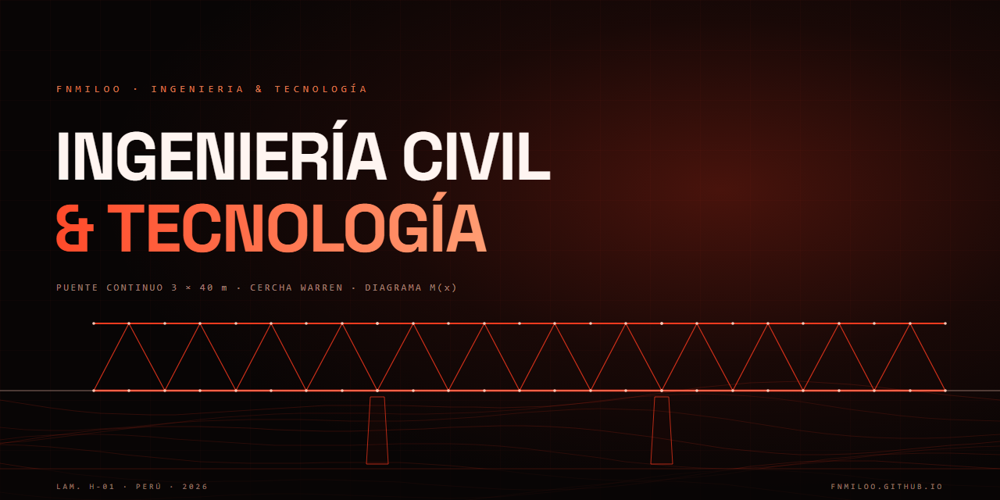

<div align="center">
  <a href="https://fnmiloo.github.io">
    
  </a>
  <br /><br />
  <a href="https://fnmiloo.github.io"></a>
  <a href="https://github.com/FNMiloo?tab=repositories"></a>
  <a href="https://fnmiloo.github.io/#contacto"></a>
</div>

<br />

## 01 · Sobre mí

Ingeniero civil enfocado en **estructuras, documentación técnica y automatización**. Diseño y calculo infraestructura; también construyo las herramientas que hacen ese trabajo más rápido, trazable y preciso.

- **Especialidad:** estructuras e infraestructura
- **Método:** cálculo + datos + software
- **Base:** Perú
- **Ahora:** automatización de expedientes, metrados y modelos digitales de terreno

## 02 · Ahora

```bash
$ fnm --now
> automatizando expedientes técnicos con Python
> procesando fotogrametría con dron y modelos de terreno
> construyendo herramientas propias para ingeniería
```

## 03 · Stack

<p>
  
  
  
  
  
  
  
  
</p>

## 04 · Proyectos

| Lámina | Proyecto | Enfoque |
| :--- | :--- | :--- |
| **H-01** | [Puente continuo 3 × 40 m](https://fnmiloo.github.io/#proyectos) | Análisis estructural, memoria de cálculo y planos |
| **H-02** | [Edificación multifamiliar](https://fnmiloo.github.io/#proyectos) | Expediente técnico, metrados y presupuesto |
| **MDT-03** | [Control de avance con dron](https://fnmiloo.github.io/#proyectos) | Fotogrametría, MDT y comparación de superficies |

## 05 · Software propio

- **FNM/Struct** — cálculo y revisión estructural.
- **FNM/Survey** — fotogrametría y modelos digitales de terreno.
- **FNM/Docs** — expedientes, metrados y presupuestos.

> El detalle de cada herramienta está en el portafolio: **https://fnmiloo.github.io/#software**

---

<div align="center">
  <a href="https://github.com/FNMiloo"></a>
  <a href="https://fnmiloo.github.io"></a>
  <br /><br />
  <sub>FNMILOO · INGENIERÍA &amp; TECNOLOGÍA · PERÚ</sub><br />
  <sub>Diseñado y construido desde cero.</sub>
</div>

<!--
  Añade aquí tu correo y tus redes cuando los tengas:
  <a href="mailto:tu-correo@ejemplo.com">Correo</a> ·
  <a href="https://www.linkedin.com/in/tu-usuario/">LinkedIn</a>
-->
